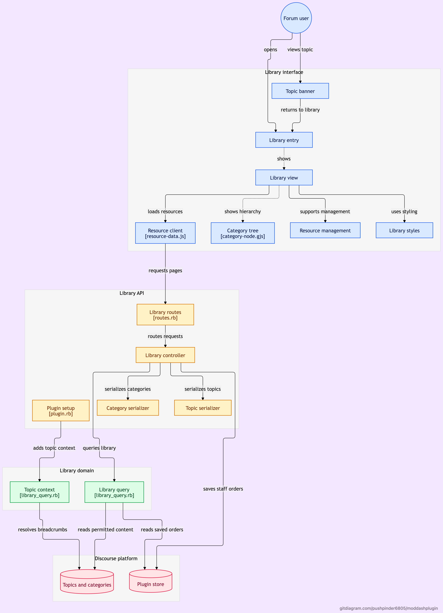

# Moddashplugin

A Discourse plugin replacing the Resource-Library theme component on Medicaid Hub.

It preserves the original three-tab layout, styles, title search, category hierarchy,
See more / Show less, newest-first ordering, permanent staff ordering, New Resource,
category management, edit/delete controls, and resource-topic banner/back link.

The default order is creation date, newest first. Staff can use the existing
Reorder mode, Move up / Move down and Save Order controls. Saved orders are stored
per category in Discourse's database (`plugin_store_rows`), returned to all permitted
users, and survive reloads, sign-outs and browser/device changes. New resources
not yet ordered appear first; existing saved relative order is preserved.
There is no runtime dependency on the old component and no use of browser storage.
The original component is the feature and design reference:
[Resources-Lib, branch 2026-10-04](https://github.com/pushpinder6805/Resources-Lib/tree/2026-10-04).

## Why a plugin

The old component discovers a directory page plus browser-cached categories, then
requests each subcategory's topic list separately. Lazy category loading can omit
categories; many subcategories multiply the requests and partial-failure points.

The plugin discovers the full permitted tree on the server, including root-category
topics. The browser calls one library endpoint and follows signed pagination cursors
in batches of 100 resources across the selected root. For example, a tab with 250
resources in 50 categories takes three library requests, rather than 50+ category
requests. It has no hard limit on category depth or search result pages.

Every request rechecks Discourse permissions, excludes private messages, shared
drafts and category-definition topics, and sends `Cache-Control: private, no-store`.
Unlisted topics retain Discourse's staff/member visibility rules. Notification mute
preferences do not remove resources from this dedicated library.

Pagination uses creation time and topic ID, with a signed cursor bound to the user,
root and search. A snapshot maximum ID keeps newly created resources from shifting
later pages. Retry preserves already visible resources; changing tabs cancels old
loads. Staff ordering is stored in Discourse's plugin store, not the admin-only theme
settings endpoint. No user-specific demo content or shared permission cache is used.

## Flow chart



## Compatibility and status

The minimum target is Discourse `2026.10.0-latest`. CI follows the official Discourse
plugin workflow and runs against `7d3d93e083b41f478616fa6447b884a50911187e`, the commit reported
by Medicaid Hub's public login page when development began. That does not replace a
preview on the site's actual theme and other installed plugins.

**Diagnostics build 0.2.0 is under test. Keep the working build installed until the new checks pass.** The previous runtime source at `fa45b80` passed all 57 tests
(25 backend, 12 frontend, 20 browser/system), lint, production eager loading,
development reloading, and boot without database/Redis.
[Verified CI run](https://github.com/pushpinder6805/Moddashplugin/actions/runs/40537040751).
Complete the staging checklist with the site's theme and other plugins before
production rollout. The plugin is disabled by default.

## Installation and migration

For a standard self-hosted Discourse Docker installation:

The repository is public. Use the HTTPS clone URL below; no deploy key, token,
or old Resource-Library component is needed.

1. Note the three root category IDs and the desired topics-per-category limit.
   The plugin starts with newest-created resources first. It does not read the old
   component's settings or saved orders. Keep the old component disabled for rollback
   if desired; the plugin does not require it to be installed.
2. In `/var/discourse/containers/app.yml`, add this line to the existing plugin clone
   commands under `hooks: after_code: exec: cmd:`:

   ```yaml
   - git clone https://github.com/pushpinder6805/Moddashplugin.git moddashplugin
   ```

   The existing hook should run in `$home/plugins`. Do not create a second `hooks`
   mapping or replace the existing plugin entries.
3. Rebuild from `/var/discourse` with `./launcher rebuild app`.
4. In Admin → Settings, search for `moddashplugin`. Set the root IDs (default
   `10|61|197`) and topics per category. No order import is needed.
5. Disable the old Resource-Library theme component on every active theme, then
   enable `moddashplugin_enabled`. The old component and plugin must not be enabled
   together: both register the same resource views.
6. Refresh the page and perform the checklist below on staging before production.

Hosted Discourse customers must confirm custom-plugin support with their host.
This is a server plugin, not a theme component that can be installed through the
Customize → Themes screen.

## Central diagnostics (0.2.0)

Open **Admin → Plugins → Moddashplugin → Diagnostics**, or
`/admin/plugins/moddashplugin/diagnostics`. Collection is enabled by default through
`moddashplugin_diagnostics_enabled`. Only administrators can read or clear reports;
the existing plugin Settings tab remains available.

Reports cover resource loads and failures, retries/recovery, title-search failures,
edit/delete/reorder failures, server exceptions in plugin endpoints, and uncaught
JavaScript/native and Ember RSVP errors whose location or stack points to this plugin. Normal navigation
cancellation is ignored. A failed load displays a reference ID for screenshots.

Filter by account, root category, reference or server request ID. Uncheck
**Failures and retries only** to see successful loads and recoveries. Expand Details
for actual/expected topic counts, categories, page/attempt counts, duration, HTTP
status, browser and plugin version/revision. HTML responses/redirects help identify
sign-in or proxy responses. Correlate server request IDs with Discourse's `/logs`.
Counts respect each account's category permissions; a smaller library can reflect
access rules rather than a loading failure.

Reports are stored centrally in Discourse's database in a separate plugin-store
namespace. History is capped at 2000 entries and displays the last 14 days. Expired
rows are pruned on the next report. Routine successful summaries are trimmed before
failures and recoveries. **Clear reports** preserves resources and permanent staff
orders. The admin-only raw endpoint is `/moddashplugin/admin/diagnostics.json`,
which remains available if the library is disabled.

The browser queues up to 20 technical reports for up to 24 hours in that tab's
session storage. Reports survive same-tab reloads and retry after connectivity or
navigation recovery; closing the tab can discard them. Event IDs prevent duplicate
reports when delivery is retried. Reporting is asynchronous, rate limited and best
effort; its failures never block resource loading.

Account identity is assigned by the server. Reports omit topic titles/content,
search text, full URLs, pagination cursors, raw error messages/stacks, credentials
and IP addresses. Refresh browsers after rebuilding to load the reporter.
Errors before plugin JavaScript executes, permanently offline/closed tabs and
incidents before installation cannot be fully reconstructed. This adds evidence
for investigation rather than a guarantee that all future errors are prevented.

## Plugin or settings missing after rebuilding

The plugin must be at `/var/www/discourse/plugins/moddashplugin/plugin.rb` inside
the running app container. A folder on the host, a nested checkout, a clone under
`$home` instead of `$home/plugins`, or rebuilding a different container will not
register it. Disabled plugins still appear under Admin → Plugins.

As a logged-in administrator, open `/admin/plugins/moddashplugin.json` on the
forum. A loaded plugin returns its metadata, including `has_settings: true` and
`enabled_setting: "moddashplugin_enabled"`. A 404 means it is not registered in
that running app process; inspect its container path and rebuild output.

On the Discourse host these checks do not modify the installation:

```sh
cd /var/discourse
./launcher exec app bash -lc 'find /var/www/discourse/plugins -maxdepth 3 -iname "plugin.rb" -path "*oddash*" -print'
./launcher exec app bash -lc 'git -C /var/www/discourse/plugins/moddashplugin rev-parse --short HEAD'
```

Check that the resource fix commit `fa45b80` or a later revision is present. Search
Admin → Settings for `moddashplugin`; it should offer enablement, root category IDs,
and the topics-per-category limit. This registration is covered by backend tests
with the plugin disabled and no old component installed.

## Staging checklist

- Compare the old and new library with the same account, viewport and theme.
- Test all three roots as a regular member, moderator and administrator. Also test
  an anonymous visitor if the forum permits anonymous access.
- Verify every permitted category/resource, especially a library with over 20
  subcategories and over 100 resources. Restricted content must stay restricted.
- Test direct loads, navigation from other pages, tab changes while loading,
  topic links, the topic banner and its Back to Resource Library link (including
  with lazy category loading enabled).
- Search titles in nested categories. Verify newest-first order, permanent staff order,
  See more / Show less, and saving an order as a moderator.
- Exercise New Resource, New Category (subject to Discourse's category-management
  permissions), edit and delete with suitable test resources.
- Simulate a failed later library request; verify the error and Retry controls,
  retained resources and recovery. Check desktop and mobile layouts.
- Check the browser console and Network panel for errors. Resource requests should
  use `/moddashplugin/library.json`, not one request per subcategory.

## Tests and development

The repository follows the official
[Discourse plugin skeleton](https://github.com/discourse/discourse-plugin-skeleton)
and adapts the official CI steps with Ruby 3.4 pinned for the site's core revision. CI runs Ruby request specs, QUnit unit
and rendered-component tests, browser system specs and the core-features regression
suite, plus Discourse's standard Ruby/JS/SCSS linters.

Inside a Discourse development checkout with this repository at
`plugins/moddashplugin`:

```sh
LOAD_PLUGINS=1 bundle exec rspec plugins/moddashplugin/spec/requests
LOAD_PLUGINS=1 bundle exec rspec plugins/moddashplugin/spec/system
LOAD_PLUGINS=1 bin/qunit --plugins=moddashplugin
```

In this repository:

```sh
pnpm install --frozen-lockfile
pnpm lint:js
pnpm lint:css
pnpm lint:prettier
bundle install
bundle exec rubocop .
bundle exec stree check Gemfile $(git ls-files '*.rb')
```

Use a Node version supported by current Discourse tooling. No database migration,
API key, external service or background job is needed. The plugin adds only its
library and staff-order routes, configuration and plugin-store records.

## Rollback

Disable `moddashplugin_enabled`, then re-enable the old theme component. Existing
Discourse topics/categories and the old component's order setting are unchanged.
New ordering changes made in the plugin remain in its plugin store. Re-enabling
the plugin restores those orders. Removing plugin code requires another rebuild.

## License

MIT. The original Resource-Library frontend is preserved and adapted from
pushpinder6805/Resources-Lib. See `LICENSE`.
